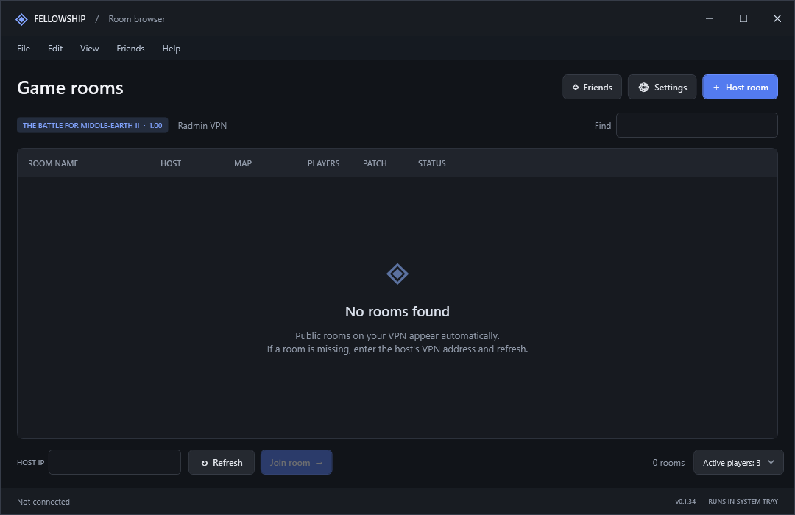
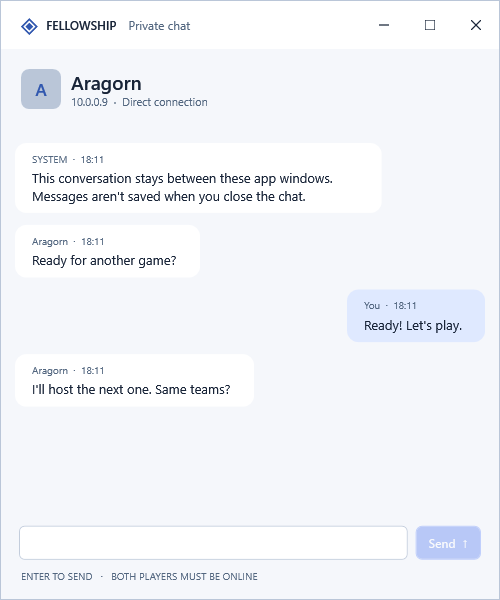
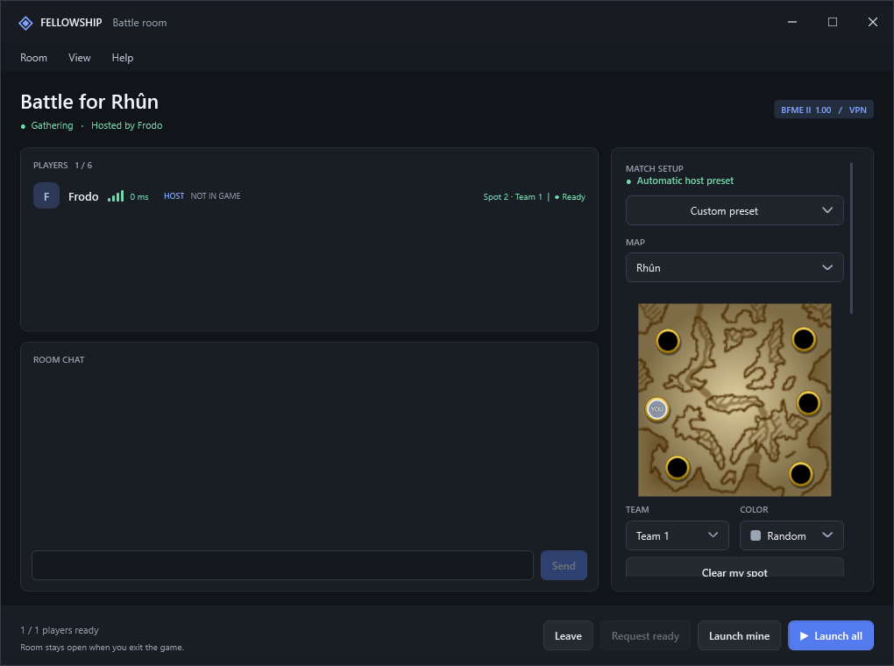
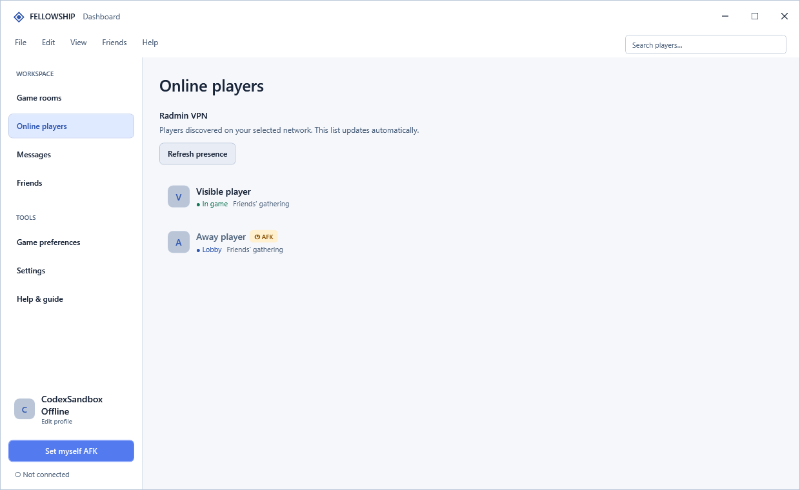
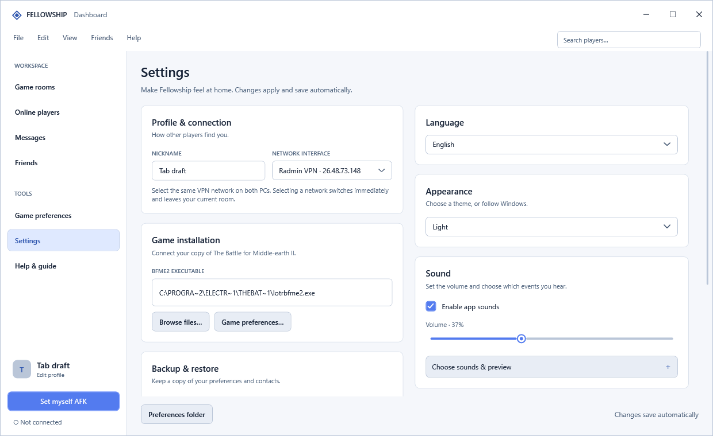

# Fellowship

### Your BFME2 games, together in one place.

[](https://github.com/Joshua131313/fellowship-bfme2/releases/latest/download/Fellowship-Setup.msi)

**Fellowship is a Windows companion for The Battle for Middle-earth II.** Find games on your VPN, gather your friends, choose a game patch, and plan teams and starting positions. Verified BFME2 1.00 installations can also carry supported selections into the native lobby. A desktop dashboard brings rooms, online players, messages, and preferences together, with separate windows when you need them.

**[Other downloads & release notes](https://github.com/Joshua131313/fellowship-bfme2/releases/latest)** · **[Report an issue](https://github.com/Joshua131313/fellowship-bfme2/issues)**



[Features](#features) · [Get started](#get-started) · [Patch support](docs/patch-support.md) · [Rhûn 3v3](#automatic-rhûn-3v3-sides-and-substitutions) · [Screenshots](#screenshots) · [Troubleshooting](#troubleshooting) · [Build from source](#build-from-source)

## Features

### Find your next game

- **Discover public rooms** on the selected VPN interface, with Radmin VPN selected by default when available. Switch networks to see that network's rooms.
- **Search and filter** by room name and game mode, then inspect the map, rules, and roster before joining. Direct host-IP joining is available when discovery misses a room.
- **Sort the room table** by its column headers, with ascending and descending indicators. Sorting and resized column widths survive tab changes and app restarts; reset widths whenever you want the default layout back.
- **See connection quality** with ping indicators in the room browser, player roster, and player information.

The room browser aligns server, mode, and search filters above the room list. The Create room form remembers your last successfully created room title, including after a restart. Use **View → Reset column ordering** or the table context menu to restore the original column order; resetting column widths is available separately.

### Find players in one Radmin group

Open the **Server** menu and hover over **Radmin VPN** to choose a group from its side menu, or use the group selector in Settings. Click **Radmin VPN** itself to use all groups available to Fellowship. The side menu opens to the left in Arabic and to the right in the other languages; refreshing keeps it open. Fellowship reads the actual group names and members from your running Radmin client and remembers your choice.

The selection filters Fellowship discovery, player lists, messaging and room connections. **Manage actual VPN group connections in Radmin.** The automatic menu-driving connection controller has been removed; Fellowship does not click Enable/Disable Network commands or fall back to that method. Switching groups leaves the current Fellowship room.

BFME2 and other applications continue to use the groups connected in Radmin. Keep Radmin running so Fellowship can refresh its member list. [Integration details and current limits](docs/radmin-groups.md).

### Build a room around your group

New rooms default to the **3v3 preset** when its map is available. On 1.00, that setup is:

> **Rhûn · 6 players · 4,000 starting resources · 2× command points · Custom Heroes off · Ring Heroes off**

On the **1.09 family**, 3v3 prefers six-player **Lebennin IV**, 2v2 prefers four-player **Lebennin**, and 1v1 uses **Fords of Isen** when present, otherwise **Fords of Isen II**. Older catalogs without the Lebennin variants retain their available Rhûn/Buckland defaults. A **4v4 Tournament Hills** preset is available for **1.06 and all 1.09 versions**. Its eight starting positions form two matching groups of four. Presets whose map is missing are disabled.

Choose built-in **3v3, 2v2, 1v1, FFA**, or the patch's **4v4** preset, save your own, or select **Custom** to edit the setup. Search the selected patch's locally available map catalog, set the player limit and hero options, and choose a public or friends-only room.

Click the map preview to claim a starting spot, choose a team and player color, and save preferred colors and per-map positions in **Game preferences**. Valid, available preferences are applied when joining. Map previews use the active theme, and player information and preview windows let you keep interacting with the rest of Fellowship.

### Choose the patch your group plays

Create room starts with your **verified installed patch**, falling back to **1.00** if the installation cannot be verified. The patch selector contains **1.00, 1.06, 1.09, 1.09v2, 1.09v3, 1.09v3.1**, and the **newest 1.09 beta** recognized from Ecth's Patch Switcher catalog. Selecting a patch refreshes the map choices, previews, starting positions, and saved presets using its locally installed archives and dependencies. Presets belong to their patch, so you can keep different setups with the same name. Changing patches with **Custom preset** selects the new patch's default map for your current team layout while keeping your custom rules. If a listed 1.09 beta is not downloaded, map browsing can use the locally available 1.09v3 map catalog; patch verification and switching still require the exact patch.

If an older beta is already verified as installed, Create room keeps that exact build selected without adding historical betas to the normal dropdown.

Fellowship checks the installed patch and shows a warning when it differs from the room's patch or cannot be verified. **You can still join the Fellowship room and chat.** Before playing, use the patch switcher to match the room's exact patch, including the beta build. Selecting a room patch does not modify your game files or run the switcher. See [patch support and map availability](docs/patch-support.md).

To use **Set to …** beside the patch warning, close BFME2 and open Ecth's Patch Switcher first. The button calls the installed switcher's native command line for **1.00**, **1.06**, or its exact supported **latest installed patch**, then checks the result. Other exact versions require manual selection in the switcher; Fellowship never substitutes the latest patch for a different requested version. The switcher's own command may close its open window while applying the patch. Creating or joining a room never starts a patch switch automatically.

### Keep the native lobby in sync

For a **verified BFME2 1.00 installation and a 1.00 room**, enabling **Live BFME2 synchronization** synchronizes supported map, rules, team, starting-position, and color selections through the game's own lobby controls. Changes can flow back from BFME2 into Fellowship, so you can make supported adjustments from inside the game.

The helper validates the supported game binary, waits for a matching, stable LAN setup lobby, checks occupied positions, and pauses writes during match transitions. Each player's helper changes that player's selections. The **BFME2 lobby host can be a different player from the Fellowship room owner**.

Each Fellowship client can synchronize its own team, spot and color even when the native game host or other players do not use Fellowship. The native lobby must use the selected map. In a mixed Rhûn 3v3 lobby, your spot moves to the right when your native team is hosting and to the left when the other team is hosting, preserving top, middle or bottom. Native team numbers stay intact. Fully managed lobbies retain the shared side plan. Other players keep control of their own selections, and only the actual native host can synchronize shared map and rule settings.

Other patches support Fellowship rooms, chat, readiness, and coordinated launching. Set their native maps, rules, teams, and spots manually in BFME2; their memory layouts have not been validated for automatic synchronization.

For a closer look at the special Rhûn rules, see [Automatic Rhûn 3v3 sides and substitutions](#automatic-rhûn-3v3-sides-and-substitutions).

### Get everyone ready and launch

- **Request ready:** the room host can prompt participants to ready up, with a dedicated ready-check sound that follows their sound preferences.
- **Launch game / Launch all:** anyone, including the host, can launch their local game with **Launch game**. The host also has **Launch all** to coordinate launching with participants who have explicitly readied up.
- **Abort locally:** while your game is running, Abort stops your own BFME2 instance. An active authorized live-sync helper reuses its permission to stop the game.
- **Keep the group together:** Fellowship rooms remain open between games. Promote another room host, hand off ownership, or manage participants without recreating the whole group.

Fellowship readiness authorizes a launch request; **BFME2's native readiness is managed separately**.

### See who is around

The **Online players** tab shows players discovered on your selected network, including people outside your friends list. Search by player name or VPN address from the dashboard, or keep the Friends window open alongside your room. Friends retain their latest confirmed nickname when they go offline and after restarting Fellowship.

Player activity distinguishes **waiting in a lobby**, **in game**, **AFK**, and **reconnecting**. Right-click a player to open player information, send a message, manage friendship or blocking, invite them, or view and join their visible game room.

Room invitations require both players to save each other as friends using their current VPN addresses. Players already in your room cannot be invited again.

AFK status can follow idle detection automatically, or you can set it yourself. **Manual AFK stays active until you mark yourself available again.** Player information shows idle duration and connection history; recent last-online times use labels such as “5 minutes ago,” with an exact timestamp on hover. Click a player's IP address to copy it.

### Chat while you organize

Use room chat for the group and private messages for individual conversations. Compact Discord-style messages show an avatar beside the player's name and time, with their text underneath and no bubble background. Longer messages wrap naturally; Arabic follows the right-to-left layout. Sent messages appear locally immediately, while delivery is still pending, and the composer stays available for your next message. Pending status stays inline and disappears after confirmation. If delivery cannot be confirmed, the message stays in place with a **Retry** action; retries and room echoes reuse its identity to avoid duplicates.

The room name appears in the window title bar, leaving the full room height for chat. A compact players card sits at the chat's top-right and fits eight rows at the default window size, while message text stays clear of it and the composer uses the full width. Collapse the card with **Hide players**, then reopen it from the players button; Arabic mirrors the card to the left. Hover a player for details or right-click for the usual player actions. A compact bottom bar keeps readiness and room actions close at hand.

Room chat shows player joins, departures, connection changes and Fellowship room host changes as compact rows with event icons and timestamps. Explicit room leaves, Fellowship disconnections and host removals have distinct wording when the room host supplies the reason. Older clients fall back to a neutral departure notice. Planned host transfers do not produce disconnect warnings, and opening a room or recovering its connection does not repeat the existing roster as new joins.

Opening a chat focuses the composer. New messages stay in view when you are at the bottom, including after scrolling up and back down. Incoming messages preserve your position while you read earlier messages; sending your own message brings it into view. HTTP, HTTPS, and `www.` links are clickable and open in your default browser. Press **Enter** to send, select text across multiple messages, or use the message context menu to copy a message or selection. Player info opens once per player and includes a **Send message** action. Player context menus open beside the cursor, preferring the right side. Sound cues and Windows notifications help you notice invitations, messages, friend activity, and new rooms.

### Make Fellowship feel like yours

| Preference | Options |
| --- | --- |
| Appearance | **Light**, **Dark**, **Black** with true-black surfaces, or **System** to follow Windows. |
| Language | **English, Français, Español, العربية, Türkçe**, including translated menus, tooltips, tray actions, and notification text. |
| Sound | Master mute, volume control, individual event toggles, and sound previews—including the ready check. |
| Notifications | Enable or disable Windows notifications for friend and room activity. |
| Game defaults | Preferred player color and starting spot for each map. |
| Backup | Export and restore preferences and contacts. |
| Startup | Choose whether Fellowship starts in the tray at Windows sign-in. |

Theme, sound, and settings changes **apply and save automatically**. First-run onboarding helps you choose language, appearance, and sound defaults and stays completed on later launches.

## Get started

### Requirements

- **Windows 10 or 11, x64.** The installer and portable build include the .NET runtime.
- Your own **BFME2 installation**, with matching patch, game files, and maps across players. Native automatic synchronization requires the verified **1.00** build. Fellowship does not include the game or patches.
- **Radmin VPN**, or another compatible IPv4 LAN/VPN connection, configured on every computer. Radmin is the default network choice when present.
- The **same current Fellowship version** on all participants, especially when using coordinated live sync.

### Your first game

1. **Install Fellowship.** Download the `.msi` from [the latest release](https://github.com/Joshua131313/fellowship-bfme2/releases/latest). The installer creates desktop and Start menu shortcuts. A portable ZIP is also available.
2. **Connect your group.** Join the same VPN network on each PC. In Fellowship, select the matching server/network interface. With Radmin, choose a specific **Radmin group** to filter Fellowship to its members. Enable or disable actual VPN group connections in Radmin itself.
3. **Set up your profile.** Complete the first-run preferences, then check your nickname and detected `lotrbfme2.exe` path in **Settings**.
4. **Host or join.** Check the preselected installed patch, or choose another room patch, and use the default 3v3 preset or another setup. If patch detection is unavailable, the initial choice is **1.00**. Join a discovered room, preview it first, or enter the host's VPN IP directly. Resolve patch warnings before playing: close BFME2, open Ecth's Patch Switcher, then use **Set to …** for a supported target or select the exact patch manually.
5. **Choose your place.** Pick your team, map spot, and color. Participants ready up when they want to permit a host launch; the host can send a ready request.
6. **Prepare and launch.** For verified 1.00 synchronization, approve Windows' permission prompt and wait for **Sync ready**. Other patches launch with manual native setup. Use **Launch game** for your local game; the host can use **Launch all** for the group.
7. **Enter BFME2's LAN lobby.** The in-game host opens **Multiplayer → Network → Create Game**. Other players join that native lobby manually. Fellowship begins supported 1.00 synchronization once the lobby matches; set the lobby options manually for other patches.

Fellowship coordinates the group and supported lobby selections. **Creating and joining the native BFME2 lobby still happens inside BFME2.** Rejoining an already-running match or restoring an army after quitting is not supported.

## Automatic Rhûn 3v3 sides and substitutions

These special rules apply **only to a 1.00 room using the 3v3 preset/mode on Rhûn, with verified 1.00 native synchronization**. Other modes and maps use normal preference and selection behavior; other patches require manual native setup.

| Situation | What Fellowship does |
| --- | --- |
| A team hosts the native BFME2 lobby | Put that team on the **right as Team 2**, with the opposing team on the **left as Team 1**. |
| The opposing team hosts the next game | Mirror positions across the map while preserving each player's top, middle, or bottom position. |
| A different player from the same team hosts | Keep the team's side and players' positions; changing the hosting player alone does not flip them. |
| The same match is replayed after a crash or OOS | Follow the hosting team's side; restore remembered vertical positions when spots reset to Random, while respecting new explicit selections. |
| Players join at different times | Assign the settled players first, then extend the plan as other players arrive. |
| A substitute joins or players exchange positions | Respect chosen free positions. Remembered positions are fallbacks, so a player can give up a spot and choose another. |

Fellowship reads the **actual BFME2 hosting player and native team selections**, then uses the previous match's lineup to identify the hosting team. The Fellowship room owner distributes the shared plan; room ownership does not decide which team hosts the game.

When the native host or other players are outside Fellowship, each client uses its own native team relationship to the host and mirrors only its own spot. Top-left pairs with top-right, middle-left with middle-right, and bottom-left with bottom-right. Same-team host changes and replayed games keep the same side. While teams are unset, a confirmed previous six-player lineup can identify a known host as your teammate or opponent; current team selections always take priority. New or ambiguous hosts wait for a selection. A blocked counterpart stays pending rather than choosing a different vertical position or moving an outsider.

Temporary observer status while connecting is allowed to settle before replacement logic acts. Existing occupied spots and explicit manual changes are respected. Hosting history lasts for the current Fellowship room; replacement history lives with the sync helper. A full app restart clears this transient history.

All participating players need the updated app and enabled live sync for coordinated changes. Simulated lobby and loopback multiplayer tests cover these rules; full multi-PC game testing remains important. See [the rotation and synchronization notes](docs/automatic-rotation.md) for implementation details and validation scope.

## Screenshots

The dashboard above shows the room browser. Expand the views below to see the lobby, player activity, and customization.

<details>
<summary><strong>Private chat — compact message rows, conversation selection, and automatic scrolling</strong></summary>



</details>

<details>
<summary><strong>Battle room — roster, chat, map positions, and launch controls</strong></summary>



</details>

<details>
<summary><strong>Online players — game activity, room names, and AFK indicators</strong></summary>



</details>

<details>
<summary><strong>Settings — appearance, language, sound, and automatic saving</strong></summary>



</details>

*Screenshots are rendered from the app with demonstration data. Map previews come from a local BFME2 installation; Fellowship downloads do not contain BFME2 or its map archives.*

## How it connects

```text
Fellowship on your PC ←──── selected LAN / VPN ────→ Fellowship on another PC
        │                                                     │
   local sync helper                                    local sync helper
        │                                                     │
   your BFME2 lobby ←──────── native game LAN ────────→ their BFME2 lobby
```

Fellowship uses direct peer connections, with **no account signup or central room service**. Discovery uses **UDP 28743**; room state, presence queries, and messaging use **TCP 28742**. GitHub provides downloads and update metadata.

- **Discovery is network-local.** Online players are discovered reachable peers, not a worldwide player directory. Firewalls and VPN routing can affect discovery.
- **Friends-only rooms follow the room host's friends list.** Their details are hidden from other peers.
- **Room connections recover from brief interruptions.** Guests keep their room and selected team, spot, and color while retrying the original host. A running host reserves a disconnected player's place for up to **120 seconds**. Launching and native synchronization pause while the room connection is unavailable.
- **Fellowship room ownership transfers through an explicit handoff.** Promoting another player or leaving as host can transfer ownership. A lost connection does not promote a guest or elect another host. If the original host has crashed, players can leave and join or create a fresh room. See [room reconnection](docs/room-reconnection.md).
- **Chat requires connectivity.** Offline message delivery and durable chat history are not implemented.

This is an unsigned community build intended for trusted groups. Player names are self-asserted, and the peer protocol does not provide encrypted messaging. Native sync supports validated BFME2 binaries; compatibility with arbitrary mods or map archives is not guaranteed.

## Updates, backups, and Windows behavior

Use **Settings → Check for updates** or the dashboard's update notice to download and install a release. The updater reopens Fellowship after installation. Settings provides backup export/restore and a shortcut to the preferences folder.

| Location | Purpose |
| --- | --- |
| `%LOCALAPPDATA%\Programs\Fellowship` | Installed application. |
| `%LOCALAPPDATA%\Fellowship` | Preferences, contacts, activity history, and support files. |

Closing the dashboard keeps Fellowship running in the system tray. Closing a battle room leaves that room and attempts a host handoff when needed. Use the tray menu's **Quit Fellowship** action to exit fully. Startup at Windows sign-in is configurable in Settings.

## Troubleshooting

| Problem | What to check |
| --- | --- |
| Rooms or players are missing | Confirm all PCs use the same VPN network, selected interface, and current app version. Refresh presence or join by host IP. Check Windows Firewall access for Fellowship on that network. |
| A player stays Reconnecting | Check that their VPN and Fellowship are still running. A brief interruption can clear after subsequent presence checks. |
| Your room loses its host connection | Restore the VPN connection and leave the room open while Fellowship retries the original host. Its owner does not change because of the interruption. If the host has crashed or the reserved place expires, leave and rejoin a reachable room, or create a fresh one. |
| Radmin groups or members cannot be read | Keep Radmin VPN running and choose **Refresh Radmin groups** from the Radmin side menu, or use the refresh button in Settings. If needed, open its main window. An unavailable selected group never silently switches to all groups. |
| BFME2 reports a DirectX error at launch | Let sync preparation and its Windows permission prompt finish before launching. If needed, disable live sync, launch BFME2, then enable sync after the game loads. |
| Live sync cannot apply a selection | Keep the native setup lobby open. Check the supported game version, matching map and participants, and occupied spots. Correct conflicting selections in BFME2 when sync pauses. |
| The room shows a patch warning | Join and chat normally. Close BFME2 and open Ecth's Patch Switcher, then use **Set to …** for 1.00, 1.06, or its exact supported latest installed patch. Other exact targets require manual selection. An unknown or mixed installation cannot enable native automation. |
| A patch's extra maps or previews are missing | Check that its files and required parent patches are downloaded locally in Ecth's Patch Switcher. Choosing a patch in Fellowship does not download or install its maps. See [patch support](docs/patch-support.md). |
| Rhûn sides do not coordinate | Confirm **1.00 + 3v3 + Rhûn**, update every participant, enable verified live sync, and select native teams. The in-game host determines the hosting side. |
| An older updater loops through repairs | Close Fellowship, run the latest release's `Fellowship-Repair-<version>.exe`, then install that release's MSI directly. The helper restores verified installer sources. If it still fails, include the installer/recovery log in your issue. |
| An update fails | Use **Open log** in the updater and include the error code and log with your report. Error 1603 can have several causes; error 1622 concerns opening the installer log. |

When [reporting an issue](https://github.com/Joshua131313/fellowship-bfme2/issues), include the Fellowship version, selected network, game version, steps to reproduce, and any relevant log or screenshot. Mention whether the Fellowship room owner and BFME2 lobby host are different players when reporting sync problems.

## Build from source

Requires **Windows**, the **.NET 9 SDK**, **Visual Studio C++ x86 build tools**, and Windows SDK libraries. The native bridge builds with the WPF app.

```powershell
# Build the desktop app and native helper.
dotnet build Fellowship/Fellowship.csproj -c Release

# Run loopback multiplayer checks and offscreen UI checks.
dotnet run --project tests/ProtocolTests.csproj -c Release
dotnet run --project ui-smoke/UiSmoke.csproj -c Release

# Publish a self-contained Windows x64 executable.
dotnet publish Fellowship/Fellowship.csproj -c Release -r win-x64 --self-contained true -p:PublishSingleFile=true -p:IncludeNativeLibrariesForSelfExtract=true -o dist/Fellowship
```

To build the MSI, publish to the versioned output folder expected by `installer/Fellowship.wixproj`, then run:

```powershell
dotnet build installer/Fellowship.wixproj -c Release
```

Protocol checks use real loopback TCP/UDP peers. UI checks render screens offscreen and exercise selections, persistence, lifecycle, localization, and update behavior. These checks complement live testing with multiple PCs and BFME2 instances.

Additional notes: [Patch support](docs/patch-support.md) · [Room reconnection](docs/room-reconnection.md) · [Rhûn rotation and native sync](docs/automatic-rotation.md) · [Player colors](docs/player-colors.md) · [Blocking](docs/blocking.md) · [Legacy room-isolation removal](docs/room-isolation.md)

---

Fellowship is an independent community project and is not affiliated with GameRanger, Radmin, Electronic Arts, or the owners of The Lord of the Rings.
