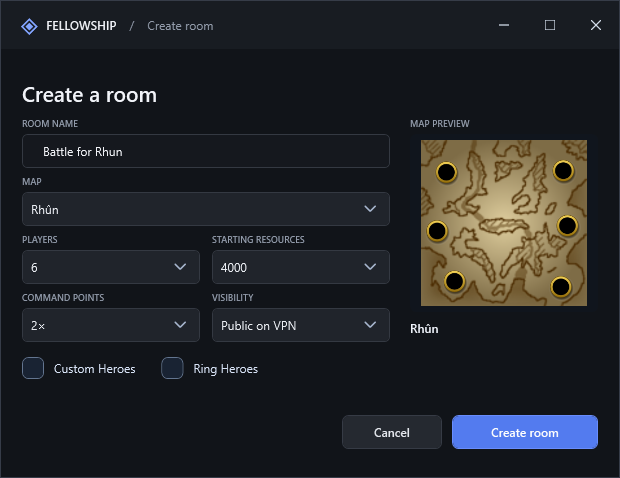
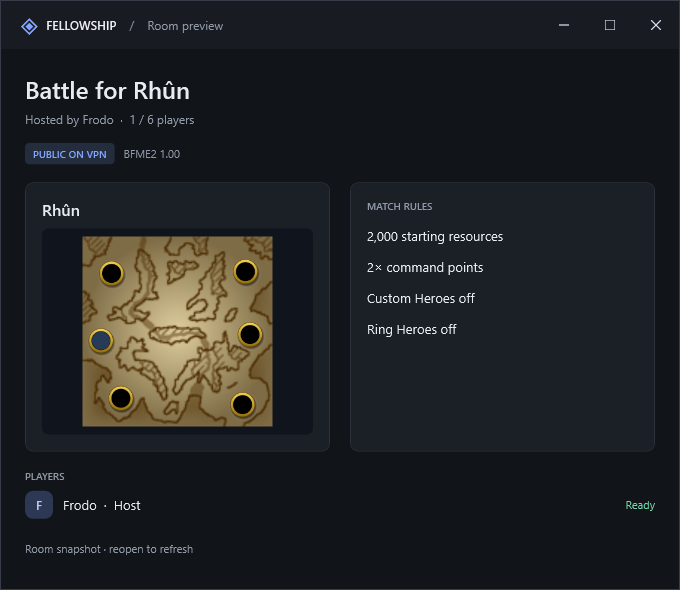
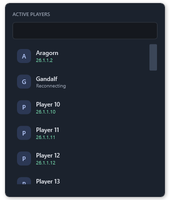

# Fellowship

### Your BFME2 games, together in one place.

Fellowship is a Windows desktop companion for **The Battle for Middle-earth II 1.00**. Find rooms, chat with friends, choose your map and rules, and coordinate game launches over **Radmin VPN**—with separate windows and a modern interface inspired by classic LAN gaming clients.

**[Download for Windows](https://github.com/Joshua131313/fellowship-bfme2/releases/latest)** · **[Release notes](https://github.com/Joshua131313/fellowship-bfme2/releases)** · **[Report an issue](https://github.com/Joshua131313/fellowship-bfme2/issues)**


## What you can do

| Feature | What it offers |
| --- | --- |
| Find a game | Discover public rooms on your VPN, search rooms, preview their rules, or join by host IP. |
| Host your way | Choose a map, player limit, resources, command points, and hero options. Make a room public or friends-only. |
| Plan your team | Click a starting spot on the map and select one of four teams. |
| Stay connected | Keep friends, private chats, the room browser, and battle rooms in separate windows. Incoming messages can play a sound. |
| See who is around | Open the searchable **Active players** dropdown. Search by name or VPN address and click someone to chat. |
| Coordinate launches | Launch your own game, or let the host launch ready players who have opted in. |
| Sync the native lobby | Synchronize supported map, rules, team, and spot settings through game data, without moving your cursor. |
| Manage the room | Promote another player to host, kick a player, or hand off the room when leaving. |
| Keep it running | Close the browser to keep Fellowship in the tray. Reopen windows from its tray menu. |
| Stay up to date | Use **Settings → Check for updates** to install the latest GitHub release. |

## A closer look

### Create a room

A compact form keeps the map, rules, privacy, and preview together. The map list is searchable and comes from your local BFME2 installation.



New rooms start with **Rhûn · 6 players / 3v3 · 4,000 resources · 2× command points · Custom Heroes off · Ring Heroes off**. The most recent host setup can be remembered for subsequent rooms.

### Preview before joining

Check the map, starting locations, rules, and player roster before entering a room.



### Find people without clutter

The active-player dropdown keeps larger groups in a scrollable list. Your own row is hidden; the button's total includes you. Player rows have subtle hover and pressed feedback.



*Screenshots are rendered from the app with demonstration data. Maps are read from a local game installation; the download does not include BFME2 or its map assets.*

## Get started

You need **Windows 10/11 x64**, your own **BFME2 1.00 installation**, and **Radmin VPN** on each computer. All players should use matching game files and the same Fellowship version.

1. **Install Fellowship.** Download the `.msi` from [the latest release](https://github.com/Joshua131313/fellowship-bfme2/releases/latest). A portable ZIP is also available; .NET is included in both builds.
2. **Connect through Radmin VPN.** Join the same VPN network on every computer.
3. **Open Settings.** Select your Radmin IPv4 address, enter a player name, and check the detected `lotrbfme2.exe` path.
4. **Host or join a room.** Public rooms appear in the browser. If discovery is unavailable, enter the host's Radmin IP. Double-click a room to join.
5. **Choose your setup.** Pick a team and starting spot. The host can edit map and rules directly in the lobby. Click Ready when you want to allow a host launch.
6. **Prepare live sync and launch.** With live sync enabled, approve Windows' permission prompt and wait for **Sync ready** before BFME2 starts. Use **Launch mine**, or let the host choose **Launch all**.
7. **Open the native LAN lobby.** In BFME2, the host opens **Multiplayer → Network → Create Game**. Guests open **Network** and join that host manually. Fellowship waits for the matching lobby before syncing supported selections.

**Fellowship currently does not create or join the native BFME2 lobby automatically.** It also cannot reconnect a player to an already-running match or restore their army after quitting.

## How it works

```text
Fellowship on your PC ←── Radmin VPN ──→ Fellowship on your friend's PC
        │                                          │
   local sync helper                          local sync helper
        │                                          │
   your BFME2 LAN lobby ←── native game LAN ──→ your friend's BFME2
```

There is no central room server or account signup. Each running app listens on the selected VPN interface. Discovery uses **UDP 28743**; rooms, presence queries, and chat use **TCP 28742**. GitHub hosts downloads and update metadata, not your game sessions.

The main app launches the local `lotrbfme2.exe`. When enabled, a separate local helper handles supported game-data synchronization. It checks the game binary and waits for an editable LAN lobby. It pauses during match transitions and leaves the native controls available for manual correction when it cannot safely sync.

The Fellowship host must also be the BFME2 host for shared map and rule synchronization. Local team and spot selections synchronize in both directions. Native guest synchronization and simultaneous conflicts across separate computers still need broader multiplayer testing.

## Presence, rooms, and selections

- **Idle players stay discoverable.** The browser and friends list share periodic presence checks, including while the app is in the tray.
- **Brief network loss is not an instant logout.** A failed query shows Reconnecting for up to 20 seconds. A confirmed closed room is removed immediately, and known peers continue being retried.
- **The active-player list is VPN-local.** It shows discovered, reachable peers—not every Fellowship user worldwide. VPN or firewall filtering can still require adding an IP manually.
- **Private rooms use the host's saved friends.** Their details are hidden from other peers.
- **Readiness stays put.** Changing a team, spot, map, or rule does not clear Fellowship readiness. BFME2 manages its own native readiness separately.
- **Spots belong to maps.** Changing maps clears old spot selections. A saved spot is restored only for its matching map when valid; otherwise it defaults to Random.
- **Existing occupants are respected.** Fellowship rejects occupied native spots, including players and AI that did not join through Fellowship. Conflicting native selections pause writes for manual correction.
- **The room can outlive the game.** Exiting BFME2 does not close the Fellowship room. Relaunching and returning to the Fellowship room is supported; ongoing-match recovery is not.

## Windows behavior

The installer uses `%LOCALAPPDATA%\Programs\Fellowship`. Preferences live in `%LOCALAPPDATA%\Fellowship`; Settings can open that folder. Startup at Windows sign-in can be disabled in Settings.

Closing the **room browser** keeps the app running in the tray. Closing a **battle room** leaves it and attempts an orderly host handoff when needed. Right-click the tray icon and choose **Quit Fellowship** to exit fully. A sudden host crash is not automatically recovered.

## Troubleshooting

| Problem | Try this |
| --- | --- |
| A friend or room is missing | Update both PCs, confirm the same Radmin network and selected VPN address, then enter the host IP directly. Check Windows Firewall access for Fellowship on that interface. |
| A player briefly shows Reconnecting | Allow a few checks for recovery. If it persists, check the VPN connection and that Fellowship is still running on the other PC. |
| BFME2 shows a DirectX error at launch | Let sync preparation and its Windows prompt finish before launching. As a fallback, disable Live BFME2 synchronization, launch the game, then enable sync after it has loaded. |
| Sync cannot apply a selection | Keep the native LAN lobby open and correct it manually. Check the matching host, map, supported game version, and whether the spot is occupied. |
| An old client cannot update | Install the latest MSI directly from GitHub. Preferences are retained. |

This is an unsigned community test build. Use it with people you trust: player names are self-asserted, and the peer protocol has no application-level authentication or encryption. BFME2 compatibility checks do not guarantee that different mods or map archives will work together. Offline messaging and durable chat history are not implemented.

## Build from source

Requires the **.NET 9 SDK**, Windows desktop targeting support, **Visual Studio C++ x86 tools**, and Windows SDK libraries. The native bridge builds with the app.

```powershell
dotnet build Fellowship/Fellowship.csproj -c Release
dotnet run --project tests/ProtocolTests.csproj -c Release
dotnet run --project ui-smoke/UiSmoke.csproj -c Release
dotnet publish Fellowship/Fellowship.csproj -c Release -r win-x64 --self-contained true -p:PublishSingleFile=true -p:IncludeNativeLibrariesForSelfExtract=true -o dist/Fellowship
```

The protocol suite uses real loopback TCP/UDP peers. UI checks render windows offscreen and exercise selection, lifecycle, and update behavior. They do not replace two-computer BFME2 testing. Native integration accepts supported game binaries and rejects unverified layouts.

To build the MSI, publish to the versioned folder expected by `installer/Fellowship.wixproj`, then run `dotnet build installer/Fellowship.wixproj -c Release`.

---

Fellowship is an independent community project and is not affiliated with GameRanger, Radmin, Electronic Arts, or the owners of The Lord of the Rings.
