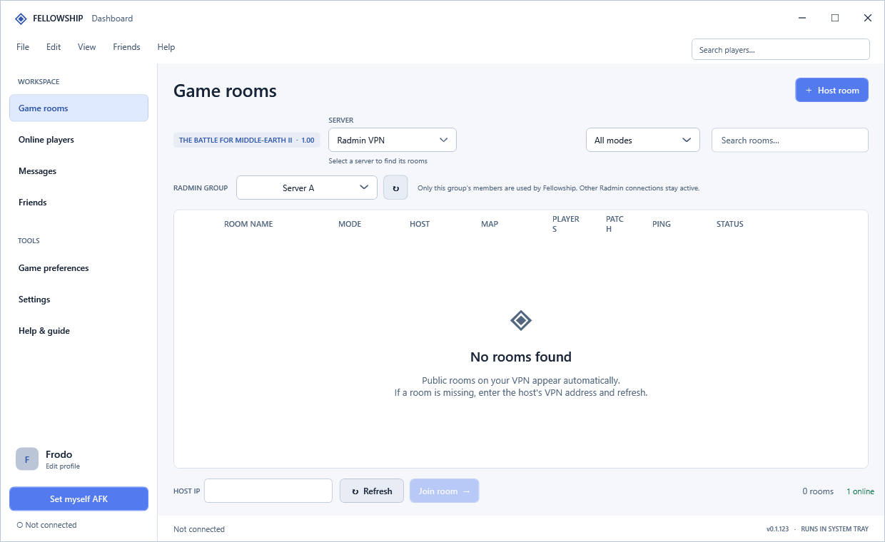

# Radmin group selection

Open **Server** and hover over **Radmin VPN** to see its groups. The side menu opens to the right in English, French, Spanish and Turkish, and to the left in Arabic. Select a group to filter Fellowship, or click the parent **Radmin VPN** item to use all groups available through the selected adapter. Settings also provides a group selector. The preference survives restarting Fellowship; switching groups leaves the current Fellowship room.

## Actual VPN connections

Enable or disable actual network connections in Radmin VPN. Version 0.1.127 removes the controller that drove Radmin's context menus one network at a time. Its worker, translated command allowlist and menu input code are not included, and there is no fallback to that mechanism. The retired worker argument is rejected without starting the dashboard or controlling Radmin.

Selecting a group in Fellowship currently filters Fellowship only. It does not enable or disable VPN groups and does not isolate BFME2's native LAN traffic or other applications.

## Read-only membership

Radmin exposes network names and displayed member IPv4 addresses through Windows UI Automation. Fellowship reads the current Windows session's `RvRvpnGui.exe` main window, identified by its `MainWindow` automation ID. It matches the selected group's `NetworkName` and reads addresses from that group's `NodesContainer` only.

For a collapsed group, the reader expands its member list and restores the original expansion state in `finally`. This reader remains in use; connection-menu automation is removed. It never invokes Enable/Disable Network, Leave or Delete commands and does not load Radmin DLLs or read passwords.

A separate process isolates the accessibility provider, with a 20-second timeout. Membership refreshes every 25 seconds while Radmin is selected. If a read fails, the last successful list is usable for at most two minutes; then unknown/out-of-scope connections remain blocked. A fresh launch requires a fresh read. Failure never broadens a selected group to all groups.

Keep Radmin running. If reading fails, open its main window and choose **Refresh Radmin groups** in the side menu or Settings. Refreshing keeps the menu open. Members hidden by Radmin's display settings may not be exposed by its UI.

## Fellowship traffic scope

- Room and presence discovery uses unicast probes to known members instead of adapter-wide broadcasts.
- Inbound UDP/TCP requests from outside the selected group are rejected before processing.
- Outgoing discovery, direct-IP joins, messages, invitations, room-owner resolution and host handoffs use the same membership policy.
- Player lists, room previews, activity alerts and ping refreshes follow that scope.
- Rooms containing participants outside the group are not joined or retained.

The local address remains allowed. A player in several Radmin groups is eligible if they belong to the selected group. This is application filtering, not a separate VPN security boundary.

## Direct integration investigation

The installed Radmin client communicates with its service through a local named pipe, `\\.\pipe\RadminVpnGuiChannel`. Its binaries contain an internal Enable Network service command. This is an undocumented service protocol, not a verified public API.

Network registry entries under `HKLM\SOFTWARE\WOW6432Node\Famatech\RadminVPN\1.0\Networks` can contain an `Enabled` DWORD. Read-only inspection confirmed its presence; default semantics, group-ID mapping and live reload behavior are not yet verified. No registry changes, service restarts or speculative native commands are shipped in this release.

## Validation

Scoped protocol tests verify inbound/outbound messaging and joins, UDP discovery, roster changes, expired/missing membership, saved preferences and non-Radmin adapters. UI checks cover saved selection, actual group labels, scoped online players, translated guidance and menu refresh behavior. Release checks confirm the connection controller and action resources are absent and the retired worker cannot run.
